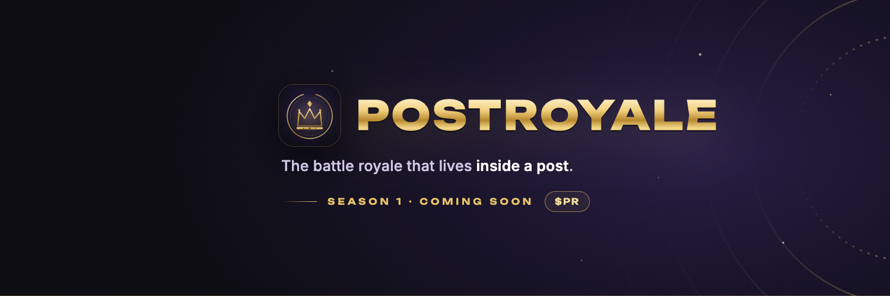
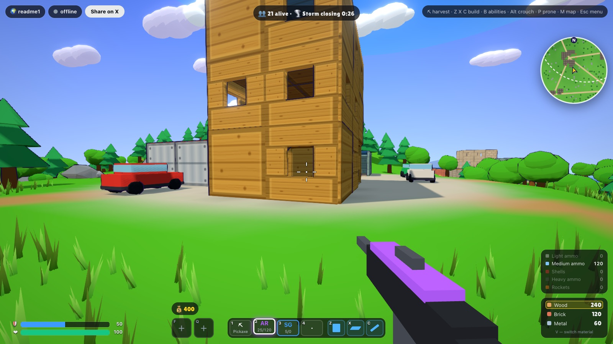
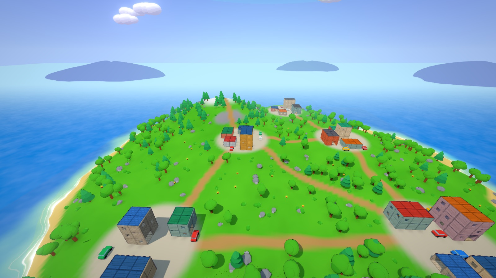
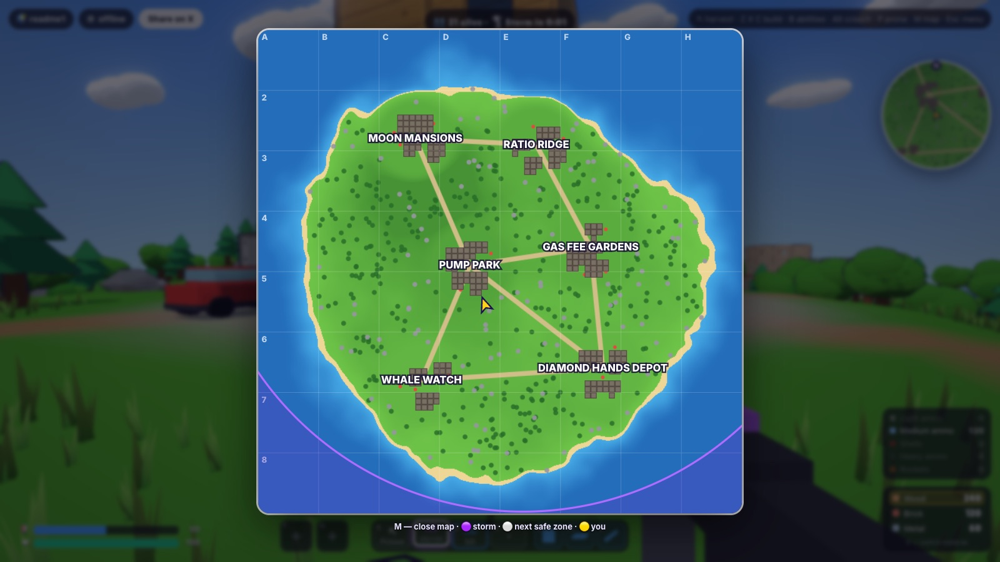
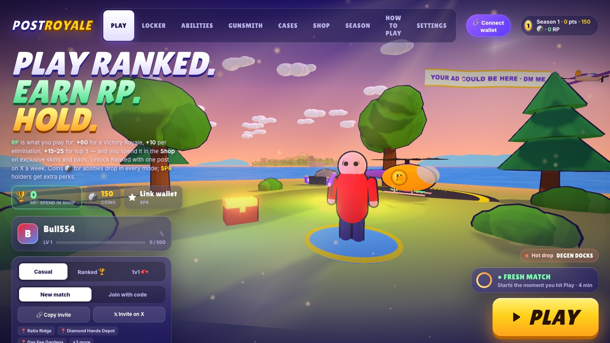
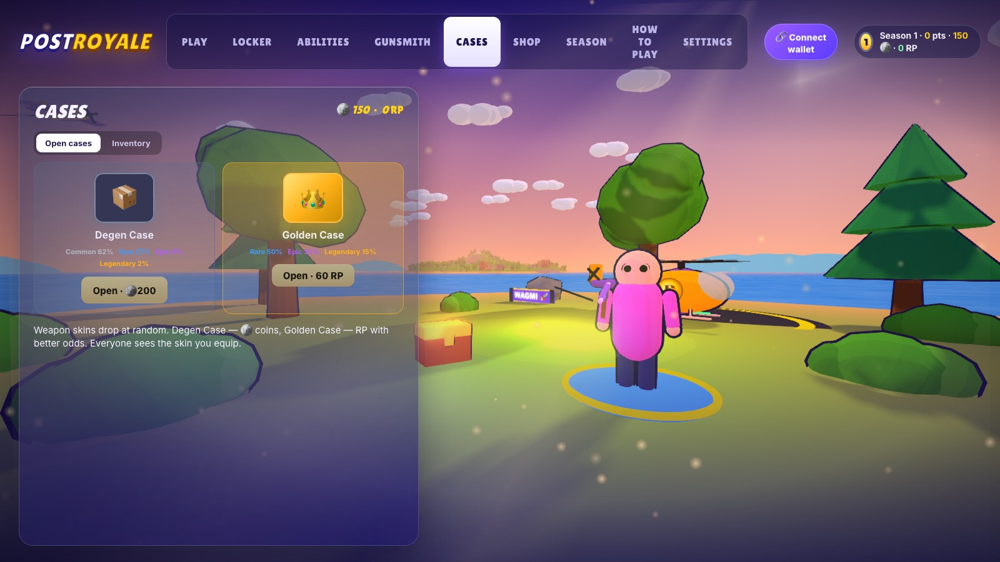

<p align="center">
  
</p>

<h1 align="center">PostRoyale</h1>

<p align="center">
  <b>The battle royale that lives inside a post.</b><br>
  Drop from a chopper, loot, build, outrun the storm — right in your browser tab. No install, no server, no account.
</p>

<p align="center">
  
  
  
  
</p>

<p align="center">
  <a href="https://postroyale-sys.github.io/postroyale/"><b>▶ Play in the browser</b></a> ·
  <a href="#run-it-locally">Run locally</a>
</p>

---

<p align="center">
  
</p>

## How it works

Hit **Play** and you get a fresh island and a link. Post the link on X — everyone who opens it drops into the same match. Up to 20 bots fill the lobby, so there is always someone to fight.

1. **Drop** — ride the helicopter over the island, jump in the jump zone, free-fall, then pop your parachute.
2. **Loot** — chests in houses and in the wild: weapons of five rarities, ammo, shields, medkits.
3. **Build** — harvest wood, brick and metal with the pickaxe, throw up walls, floors and ramps.
4. **Survive** — the storm closes in. Last one standing takes the **Victory Royale**.

<table>
  <tr>
    <td width="50%"></td>
    <td width="50%"></td>
  </tr>
  <tr>
    <td width="50%"></td>
    <td width="50%"></td>
  </tr>
</table>

## Features

**Gameplay**
- Procedural island per match: six towns with multi-storey houses, roads, forests, beaches, cars and fuel barrels that explode when shot (barrels chain-react), trees that fall when cut.
- Rounds by day, morning, sunset, night (stars, moonlight) or in the rain with thunderstorms.
- Helicopter drop with a jump zone, free-fall and parachute; redeploy the chute when falling from a height.
- Weapons: pistol, SMG, assault rifle, shotgun, sniper, bazooka — five rarities, recoil, spread, reloads.
- Building: walls, floors, ramps in three materials; everything is destructible.
- Crouch, prone, sprint, slide, aim down sights; mushroom launch pads throw you 17 m up.
- **The Roadster**: three electric hypercars per round (follow the cyan beams) — 0–100 km/h in under a second with launch mode, air thrusters to jump, kickflip and hover, ram players and bots, drives on water.
- Storm with phases that shrink to a final circle — a siren warns 10 s before each shrink, and the final circle moves.
- Three supply drops per round (epic+ loot on a parachute, follow the purple beam) and a Pump zone with +30% damage.
- Big glowing damage numbers, headshots, kill confetti with PR coins, multi-kill streaks, slow-mo on the last kill, killcam, spectator camera and a victory orbit with confetti.
- Minimap and full island map (**M**) with the storm, next safe zone and the chopper route.
- Up to 20 bots that loot, build-break, strafe, flank and parachute to their own landing spots.
- Full sound: a distinct shot per gun with distance falloff and echo, reload and bolt/pump mechanics, footsteps by surface, wind and parachute, medkits, loot, hits and kills, plus lobby music. All synthesized in the browser, no audio files.

**Modes**
- **Casual** — a fresh match the moment you hit Play; friends join from your link.
- **Ranked** — one shared island per day, earn **RP**. Unlocked with one post on X.
- **1v1 duel — ticker vs ticker.** Enter two coins (`$BONK` vs `$WIF`), send the challenge link, fight for your ticker.

**Progression**
- **Abilities** (Valorant-style): dash, moon jump, shield, smoke, recon, grenade and an **FPV kamikaze drone**.
- **Gunsmith**: optics (red dot, holo, ACOG 3x), double mags, grips, fast reloads — visible on the gun.
- **Cases**: weapon skins from 77 finish × weapon combos, CS-style roll, inventory.
- **Skins**: 16 character skins.
- **Season** levels, coins and RP. RP and coins have no cash value yet — the $PR token launch is in the works.

## Controls

| Action | Key |
|---|---|
| Move · sprint · jump | `W A S D` · `Shift` · `Space` |
| Shoot · aim | Left click · Right click |
| Weapons | `1`–`4` |
| Medkits (select, then left click to heal) | `5` |
| Emotes | `J`, then `1`–`4` |
| Build wall · floor · ramp · switch material | `Z` · `X` · `C` · `V` |
| Crouch · slide · prone | hold `Alt` · `Alt` while sprinting · `P` |
| Open chest · swap weapon · reload | `E` · `G` · `R` |
| Roadster: get in/out · drive · launch · thrusters (+`A`/`D` kickflip, hold to hover) | `E` · `W A S D` · `Shift` · `Space` |
| Abilities · buy menu | `F` `Q` · `B` |
| Map | `M` |
| Jump out of the chopper / open parachute | `Space` |
| Spectate: next · previous · free camera | Left click · Right click · `V` |
| Menu | `Esc` |

## Tech

- **Rendering:** [three.js](https://threejs.org) r170 — toon shading with outlines, instanced foliage and wind, shader water, bloom, colour grading, FXAA.
- **Multiplayer:** [Trystero](https://github.com/dmotz/trystero) — WebRTC peer-to-peer, matchmaking over public Nostr relays. Matches are keyed by the link, rounds by the clock, so there is no game server.
- **Code:** plain ES modules, no bundler and no build step. Open `index.html` through any static server.

| Module | What it does |
|---|---|
| `main.js` | game loop, player, lobby UI, wiring |
| `map.js` · `structures.js` | island generator · buildings, objects, building and destruction |
| `combat.js` · `viewmodel.js` | weapons, damage, explosions · first-person guns and attachments |
| `audio.js` | synthesized sound effects, positional playback, lobby music |
| `royale.js` | rounds, storm phases, winners, duel rules |
| `bots.js` | bot AI: looting, movement, aim, building-breaking, drops |
| `heli.js` · `lobby.js` | helicopter and parachute · lobby island and ad plane |
| `abilities.js` · `loadout.js` | abilities and drone · coins and ability stock |
| `gunsmith.js` · `wskins.js` | attachments · weapon skins and cases |
| `minimap.js` | minimap and full map |
| `net.js` | P2P actions |
| `season.js` · `ranked.js` · `skins.js` | levels and wallet · Ranked and RP shop · character skins |

## Run it locally

```bash
git clone https://github.com/PostRoyale-sys/postroyale.git
cd postroyale
python3 serve.py 8766        # static server with caching disabled
```

Open <http://127.0.0.1:8766>. Any static file server works; `serve.py` just turns caching off while you edit.

Developer notes and the full changelog (in Russian) live in [`docs/DEV.md`](docs/DEV.md).

---

<p align="center"><sub>PostRoyale is an independent project and is not affiliated with any game studio. RP and coins are in-game points with no cash value for now; the $PR token is in development. Nothing here is financial advice.</sub></p>
